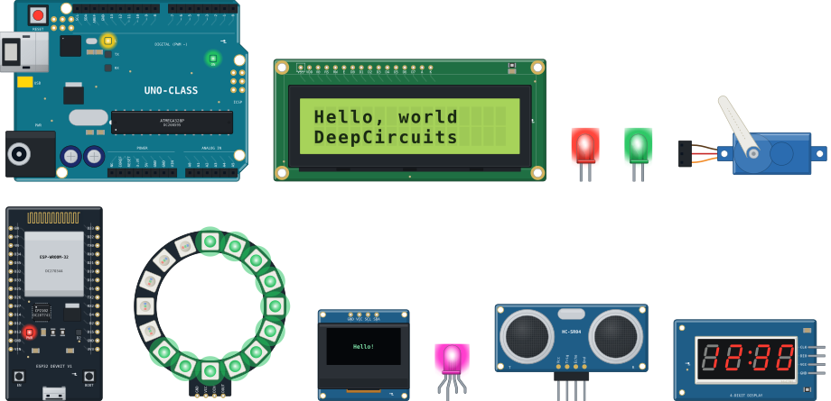

<div align="center">



# DeepCircuits Parts Kit

**Original electronic part artwork, drawn by code.**

Boards, chips, sensors, displays and modules as SVG, each at true size on the 0.1-inch grid, with its pins and its live state.

[](LICENSE)
[](src/index.d.ts)
[](package.json)

[**Gallery**](https://deepcircuits.github.io/deepcircuits-parts-kit/) · [Catalog](#the-catalog) · [API](#api) · [Brand book](project/README.md) · [Contributing](CONTRIBUTING.md)

</div>

---

The Parts Kit is the artwork of [DeepCircuits](https://deepcircuits.io), the circuit simulator. It is published on its own so any editor, simulator, tutorial or diagram can use it. Call a function and get back an SVG and the position of every pin.

- **True size.** Parts are drawn at their real size, and every pin sits on the 0.1-inch grid (9.6 px at 96 dpi), so parts line up on a breadboard and wires snap to their legs.
- **Live state.** LEDs light, screens show text and pictures, servos turn and buttons press. You set the state as an option, and the SVG can be updated in place.
- **Typed options.** Each part's options have types, ranges and defaults. A typo such as `angel` fails in TypeScript, and at run time the error names the option you meant.
- **Themes.** Colours come from design tokens with light and dark values, and can follow your page's theme.
- **No dependencies.** Plain functions that return strings. They work in any framework, in Node, in a worker or on a server, with no DOM.
- **Checked on every build.** Nothing overlaps, text stays readable, every option changes the drawing, and pins, legs and line widths follow the published conventions for breadboard part graphics.
- **Original and MIT licensed.** The code and the artwork are MIT. Nothing is copied from other part libraries, and boards carry no logos.

## Install

The kit is not on npm. Install it from GitHub:

```bash
npm install github:deepcircuits/deepcircuits-parts-kit
```

The repository includes the built files, so there is no build step. Without a bundler, load the script from jsDelivr. It defines `window.PartsKit` and the `<parts-kit-part>` element:

```html
<script src="https://cdn.jsdelivr.net/gh/deepcircuits/deepcircuits-parts-kit@main/project/components/bundle.js"></script>
```

## Three ways to use it

| You want | Use |
| --- | --- |
| A picture of a part for a document, a slide or a design tool | The [picture files](#pictures) |
| Parts on a web page without writing code | The [`<parts-kit-part>` element](#on-a-page-parts-kit-part) |
| Parts in an editor, a simulator or a build step | [`drawPart`](#in-code-drawpart), which returns the SVG and its pins |

### Pictures

[`images/`](images/) has every part as an SVG file: at rest, in each state (lit, pressed, energised), with sample content, and in each colour. Its [README](images/README.md) shows them all, and [`manifest.json`](images/manifest.json) lists each part's size, pins and files. Copy the files you need, or link to them on jsDelivr:

```html

```

Pictures are true size (0.1 inch is 9.6 pixels), so set a width to show a small part larger.

### On a page: `<parts-kit-part>`

```html
<script src="https://cdn.jsdelivr.net/gh/deepcircuits/deepcircuits-parts-kit@main/project/components/bundle.js"></script>

<parts-kit-part type="led-5-mm" color="green" on></parts-kit-part>
<parts-kit-part type="servo" angle="45" scale="2"></parts-kit-part>
<parts-kit-part type="character-lcd-16x2" lines='["Hello, world", "DeepCircuits"]'></parts-kit-part>
```

`type` is the part's id, and every other attribute is an option. Change an attribute and the part redraws. Buttons press, knobs turn and switches flip with a mouse, a finger or the keyboard. A misspelt option shows an error in place of the part: `servo has no option "angel"; did you mean "angle"?`. With a bundler, `import '@deepcircuits/parts-kit/element'` defines the element and loads each family of parts when it is first used. See [the part element](#the-part-element) for the details.

### In code: `drawPart`

```js
import { drawPart } from '@deepcircuits/parts-kit';

// Any part in the catalog, by id, with its options.
const lcd = drawPart('character-lcd-16x2', { lines: ['Hello, world', 'DeepCircuits'] });
container.innerHTML = lcd.svg;
lcd.pins; // [{ name: 'VSS', x: 30.24, y: 9.45 }, { name: 'VDD', … }, …]

drawPart('servo', { angel: 30 });
// TypeScript: 'angel' does not exist in type '{ angle?: number }'. Did you mean to write 'angle'?
// JavaScript: Error: servo has no option "angel"; did you mean "angle"? Its options are angle.
```

Each part also has its own generator. It takes the same options, plus any that the catalog entry fixes:

```js
import { led, resistor } from '@deepcircuits/parts-kit';

const red = led({ color: 'red', on: true, brightness: 0.6 });
const r = resistor({ ohms: 4700 }); // the colour bands follow from the resistance
```

In React, insert the SVG string directly. Any text you pass in (a caption, a label, an LCD line) is escaped first, so it is safe:

```jsx
import { useMemo } from 'react';
import { drawPart } from '@deepcircuits/parts-kit';

export function Part({ id, options }) {
  const art = useMemo(() => drawPart(id, options), [id, options]);
  return <span dangerouslySetInnerHTML={{ __html: art.svg }} />;
}
```

On a plain page:

```html
<div id="bench"></div>
<script src="https://cdn.jsdelivr.net/gh/deepcircuits/deepcircuits-parts-kit@main/project/components/bundle.js"></script>
<script>
  document.getElementById('bench').innerHTML = PartsKit.drawPart('servo', { angle: 45 }).svg;
</script>
```

## Recipes

### With the pictures

#### Put a part in a document

Markdown, wikis and slides take the files as they are, and Figma and Inkscape open them as vector drawings:

```markdown

```

Markdown shows a picture at true size. Where HTML is allowed, an `` with a `width` shows it larger.

#### Show a state by swapping pictures

Each state is its own file, so a page can switch states without any of the kit's code. Click the LED to light it:

```html

<script>
  const images = 'https://cdn.jsdelivr.net/gh/deepcircuits/deepcircuits-parts-kit@main/images/';
  const led = document.getElementById('led');
  let lit = false;
  led.addEventListener('click', () => {
    lit = !lit;
    led.src = `${images}led-5-mm${lit ? '--on' : ''}.svg`;
    led.alt = lit ? 'A lit red LED' : 'A red LED';
  });
</script>
```

#### Read a part's pins in any language

`manifest.json` has every part's size and pin positions, for drawing wires or labels over a picture. In Python:

```python
import json
from urllib.request import urlopen

URL = 'https://cdn.jsdelivr.net/gh/deepcircuits/deepcircuits-parts-kit@main/images/manifest.json'
parts = {part['id']: part for part in json.load(urlopen(URL))['parts']}

uno = parts['uno-class-board']
print(uno['width'], uno['height'])  # 275.07 201.6, in CSS pixels at 96 dpi
for pin in uno['pins'][:3]:
    print(pin['name'], pin['x'], pin['y'])  # A5.2 85.64 9.6, then A4.2 and AREF
print([image['file'] for image in uno['images']])  # ['uno-class-board.svg', 'uno-class-board--indicators-lit.svg']
```

Positions are measured from the part's top-left corner. If you show a picture at another size, multiply them by the shown width divided by the part's `width`.

### With the element

#### Light an LED while a button is held

Hold the button down, or focus it and hold Space. Each press and release fires `input` with the options that changed:

```html
<parts-kit-part id="button" type="pushbutton" scale="2"></parts-kit-part>
<parts-kit-part id="led" type="led-5-mm" color="green" scale="2"></parts-kit-part>
<script>
  const led = document.getElementById('led');
  document.getElementById('button').addEventListener('input', event => {
    led.toggleAttribute('on', event.detail.pressed);
  });
</script>
```

#### Dim an LED with a knob

Drag the knob around, or focus it and use the arrow keys:

```html
<parts-kit-part id="knob" type="potentiometer" scale="2"></parts-kit-part>
<parts-kit-part id="lamp" type="led-5-mm" color="yellow" on brightness="0.5" scale="2"></parts-kit-part>
<script>
  const lamp = document.getElementById('lamp');
  document.getElementById('knob').addEventListener('input', event => {
    lamp.setAttribute('brightness', event.detail.position);
  });
</script>
```

#### Type on a keypad

Click the keys, or focus the keypad and type. The `press` event names the key:

```html
<parts-kit-part id="keypad" type="keypad-4x4"></parts-kit-part>
<output id="typed"></output>
<script>
  const typed = document.getElementById('typed');
  document.getElementById('keypad').addEventListener('press', event => {
    typed.value += event.detail.key;
  });
</script>
```

#### Sweep a servo

The element only updates what changed, so it can redraw every frame:

```html
<parts-kit-part id="servo" type="servo" scale="2"></parts-kit-part>
<script>
  const servo = document.getElementById('servo');
  let angle = 0;
  let step = 3;
  setInterval(() => {
    if (Math.abs(angle + step) > 90) step = -step;
    angle += step;
    servo.setAttribute('angle', angle);
  }, 30);
</script>
```

#### Show the time on an LCD

Lists are easier to set from code, with the element's `options` property:

```html
<parts-kit-part id="lcd" type="character-lcd-16x2"></parts-kit-part>
<script>
  const lcd = document.getElementById('lcd');
  const show = () => (lcd.options = { lines: ['The time is', new Date().toLocaleTimeString('en-GB')] });
  show();
  setInterval(show, 1000);
</script>
```

### With `drawPart`

#### Wire two parts together

Every drawing comes with its pins, so you can draw a wire from one pin to another. Place each part, then add its position to its pins:

```js
import { drawPart } from '@deepcircuits/parts-kit';

const parts = [
  { art: drawPart('resistor', { ohms: 220 }), x: 20, y: 80 },
  { art: drawPart('led-5-mm', { on: true }), x: 100, y: 20 },
];
const pin = ({ art, x, y }, name) => {
  const p = art.pins.find(p => p.name === name);
  return { x: x + p.x, y: y + p.y };
};
const from = pin(parts[0], '2'); // the resistor's right leg
const to = pin(parts[1], 'A'); // the LED's anode

bench.innerHTML = `<svg xmlns="http://www.w3.org/2000/svg" width="160" height="110">
  ${parts.map(({ art, x, y }) => art.svg.replace('<svg ', `<svg x="${x}" y="${y}" `)).join('')}
  <path d="M${from.x} ${from.y} H${to.x} V${to.y}" fill="none" stroke="#e11d48" stroke-width="2" stroke-linecap="round"/>
</svg>`;
```

`partPins(id, options)` returns the pins without drawing, and `rotateArtwork` turns a part and its pins.

#### Save parts as files

In Node or a build step:

```js
import { writeFileSync } from 'node:fs';
import { drawPart } from '@deepcircuits/parts-kit';

const chip = drawPart('ne555-timer');
// A file has no page colour to inherit, so give the pin names an ink colour.
writeFileSync('ne555.svg', chip.svg.replace('<svg ', '<svg color="#020817" '));
```

## The catalog

101 parts in ten families. The [gallery](https://deepcircuits.github.io/deepcircuits-parts-kit/) shows every part and every generator's card.

| Family | Parts |
| --- | --- |
| Boards (17) | Uno-, Nano- and Mega-class boards, Pico-class and RP2040 Nano-class boards, eight ESP32 dev boards (30- and 38-pin, C3, C5, C6, H2, S2, S3), two STM32 boards, the Blue Pill, Franzininho DIY |
| Displays (16) | 16×2 and 20×4 character LCDs, three OLEDs, two TFTs, an 84×48 LCD, a 2.9″ e-paper, seven-segment and clock displays, 8×8 LED matrices and a chain of four, an 8×8 RGB matrix, a 16-LED ring |
| Sensors (16) | Ultrasonic ranger, temperature and humidity, two pressure boards, light, flame, sound, tilt and gas boards, IR receiver, NTC thermistor, PIR motion, accelerometer and gyro, pulse, DS18B20 |
| Inputs (11) | Two pushbuttons, rotary and slide potentiometers, slide switch, rotary encoder, joystick, 4×4 keypad, 8-way DIP switch, IR remote, rotary dialer |
| Outputs (10) | 5 mm LED, RGB LED, LED bar graph, addressable LED and strip, piezo buzzer, servo, stepper and biaxial stepper, DPDT relay |
| Modules (7) | Relay module, load cell amplifier, microSD card, real-time clock, RFID reader, logic analyzer, pixel meter |
| Chips (5) | NE555, 74HC595, 74HC165, NLSF595, ATtiny85, each in DIP, SOIC or TSSOP |
| Passives (3) | Resistor, electrolytic and ceramic capacitors |
| Breadboards (3) | Mini, half and full, in nine colours |
| Symbols (13) | Eight logic gates, multiplexer, two D flip-flops, clock source, supply |

`CATALOG` lists every part, for a part picker. Each entry has an `id`, a `name`, a `family`, its generator `fn`, the `preset` options that make the part, the `options` you can set, which of those are `state`, and `aliases` to search by.

```js
import { CATALOG, drawPart, searchParts } from '@deepcircuits/parts-kit';

for (const part of CATALOG.filter(p => p.family === 'sensor')) {
  picker.add(part.name, drawPart(part.id).svg);
}
searchParts('hcsr04'); // [{ id: 'ultrasonic-ranger', name: 'Ultrasonic ranger', … }]
```

### Options

Each entry's `options` describe what the part takes:

```js
CATALOG.find(p => p.id === 'servo').options;
// { angle: { type: 'number', label: 'Angle', min: -90, max: 90, step: 1, unit: '°', default: 0, state: true } }
```

A host can build its controls from them:

- `type` picks the control: `boolean`, `number`, `level`, `enum`, `color`, `text`, `frame`, `list`, `object` and a few more.
- `min`, `max`, `step` and `choices` set it up.
- `when` says which other values an option needs before it has any effect. `optionApplies(spec, values)` checks it.
- `examples` give values a control can't build from the type alone, such as a picture or a glyph.

`checkOptions(id, options)` lists what is wrong with a call without drawing it. The types in `project/components/catalog.d.ts` (`PartId`, `PartOptions<'servo'>` and `PartCall`) are generated from the same data.

### Ids and pin names

A published id always draws the same part. An id is the part's name in lower case, with a hyphen for each run of other characters (`Character LCD, 16×2` is `character-lcd-16x2`). Renamed ids still work, and `RENAMED_IDS` maps them to their new names.

Pin names come from the part's data sheet or the printing on the board (`A` and `K` on an LED, `VSS` to `K` on a character LCD). When a name repeats on a part, the first is bare and the rest get `.2`, `.3` and so on (`GND`, `GND.2`). The printing on the drawing leaves the suffix off, as on the real board.

### Templates

`@deepcircuits/parts-kit/templates` has the templates the catalog is built from, for making parts of your own:

- `devBoardTemplate`: a board with your pin names.
- `moduleTemplate` and `sensorModuleTemplate`: a breakout board with your chip or sensor.
- `chipTemplate`: a DIP, SOIC or TSSOP chip with any even number of pins.
- and more.

```js
import { chipTemplate } from '@deepcircuits/parts-kit/templates';

const timer = chipTemplate({ label: 'NE555', pins: ['GND', 'TRIG', 'OUT', 'RESET', 'CTRL', 'THR', 'DIS', 'VCC'] });
```

## API

### Artwork

Every generator takes an options object and returns an `Artwork`. The types are in [`src/index.d.ts`](src/index.d.ts).

| Field | Meaning |
| --- | --- |
| `width`, `height` | The part's size in CSS pixels at 96 dpi. |
| `svg` | The drawing. It has an explicit size, its own `<defs>`, and presentation attributes only (no `<style>`, no `style=""`). It has `role="img"` and an `aria-label` that names the part and, for simple states, says the state too (a lit LED, a pressed button, a servo's angle, an LCD's text). Board lamps and screen pictures are left for the host to describe. |
| `pins` | Each pin's `name`, `x` and `y` within the part. Every pin is a whole number of pitches (0.1 inch) from the first. |

`partPins(id, options)` returns a part's `width`, `height` and `pins` without the SVG. It draws the part once for each set of options and remembers the result.

### State options

A state option has the same name on every part that has it. `CATALOG` lists each part's own.

| Option | Meaning | Parts |
| --- | --- | --- |
| `on`, `brightness` | A light is on, and how bright (0 to 1) | `led`, `pulseSensor` |
| `indicators` | A board's lamps by name (`power`, `user`, `out`, `status`), each on or a level from 0 to 1 | boards, sensor and relay modules |
| `levels` | Each light's level from 0 to 1, in order | `ledBarGraph`, `sevenSegment` |
| `colors`, `color`, `r` `g` `b` | Pixel colours | `neopixel`, `ledRing`, `neopixelMatrix`, `ledStrip`, `rgbLed` |
| `lit` | Which lights are on, by row or channel | `max7219Matrix`, `logicAnalyzer` |
| `value` | The characters shown | `sevenSegment`, `tm1637Module` |
| `lines`, `pixels`, `caption` | An LCD's text; a screen's picture or line of text | `characterLcd`, the screen modules |
| `pressed` | A button or key is held down | `pushbutton`, `joystick`, `rotaryEncoder`, `keypad`, `irRemote` |
| `position` | How far it has moved, from 0 to 1 | `potentiometer`, `slidePotentiometer` |
| `contact` | Which pin, 1 or 3, a slide switch's middle pin connects to | `slideSwitch` |
| `angle`, `detent`, `x` `y` | Turned in degrees or by detents, or pushed (-1 to 1, positive is right and up) | `servo`, `stepper`, `rotaryDialer`, `rotaryEncoder`, `joystick` |
| `energised` | A relay's coil is energised | `relay` |
| `live` | Current along the legs (`flow`: `true`, or `'reverse'` for the other way), heat, and a probe on a pin | `resistor`, `led`, `buzzer` |

### Changing state in place

Redrawing is cheap, but replacing the SVG loses focus and pointer capture. `patchSvg(host, artwork)` from `@deepcircuits/parts-kit/dom` changes only what differs, so a control that is being dragged stays where it is:

```js
import { drawPart } from '@deepcircuits/parts-kit';
import { patchSvg, findHook } from '@deepcircuits/parts-kit/dom';

patchSvg(host, drawPart('potentiometer', { position: 0.3 }));
findHook(host, 'knob').setAttribute('tabindex', '0'); // kept across later patches
```

Moving parts have `data-hook` attributes (`lens`, `glow`, `knob`, `horn`). Select them with `[data-hook="lens"]`, not by id, so two parts on one page never clash. State is also written to `data-*` attributes (`data-segment`, `data-pressed`, and `data-angle` with its pivot in `data-cx` and `data-cy`). Current along a leg is `data-live="flow"`, which `bundle.css` animates. The brand book's *States and hooks* and *The live layer* list every hook.

### The part element

`<parts-kit-part>` draws a part in its shadow root. When an attribute or its `options` change, it updates the drawing in place with `patchSvg`. Importing `@deepcircuits/parts-kit/element` defines it, and so does the script from jsDelivr.

| Attribute or property | Meaning |
| --- | --- |
| `type` | The part's id. Renamed ids work too. |
| An option, such as `color` or `angle` | The option as an HTML attribute. `on` or `on=""` is true, and `on="false"` is false. A camelCase name can be written in kebab-case (`pixel-size`), and an object's field after the object's name (`live-flow="reverse"`). Lists and objects are JSON (`lines='["Hello", "World"]'`). |
| `scale` | Shows the part at that many times its true size (1 by default). CSS can size it too: a smaller width shrinks it to fit. |
| `static` | Draws the part without its controls, as a still picture of a state. |
| `options` | Options set from code, on top of the attributes. The easy way to pass a list or a picture. |
| `artwork`, `pins` | The last drawing and its pins, in the drawing's pixels before `scale`. |
| `hook(name)` | A drawn element by its `data-hook`, such as `lens` or `knob`. |
| `error` | Why the last drawing failed, or null. The element shows the message where the part would be (style it with `::part(error)`) and logs it. |

The element fires `draw` after each drawing, with the artwork in `event.detail.artwork`. Pin names and other print on the canvas take the element's `color`. Standard HTML attributes (`id`, `class`, `style`, `aria-*`, `data-*`) are not options. `definePartElement(name)` defines the element under another tag name, and `optionsFromAttributes(id, attributes)` reads attributes the way the element does.

#### Parts you can operate

The input parts work with the pointer and, once focused by a click or Tab, with the keyboard:

| Part | Pointer | Keyboard | Changes |
| --- | --- | --- | --- |
| Pushbutton, 6 mm pushbutton | Hold it down | Hold Space or Enter | `pressed` |
| Slide switch | Click | Space or Enter flips it; Left and Right pick a side | `contact` |
| DIP switch | Click a lever | 1 to 8 flip that lever | `values` |
| Potentiometer | Drag the knob around | Arrows step 1%, Page Up and Page Down 10%, Home and End go to the ends | `position` |
| Slide potentiometer | Drag along the slot | Same as the potentiometer | `position` |
| Rotary encoder | Drag around to turn it one detent at a time; click or hold to press the shaft | Arrows turn it; Space or Enter press it | `detent`, `pressed` |
| Joystick | Drag the stick, which springs back; click or hold to press | Arrows push it (a quarter of the way with Shift); Space or Enter press it | `x`, `y`, `pressed` |
| Keypad | Hold a key, or several keys with several fingers | The key's label: 0 to 9, A to D, * and # | `pressed` |
| IR remote | Hold a key | 0 to 9; Up, Down, Left and Right (previous, next); Space or Enter (play); + and - (volume) | `pressed` |
| Rotary dialer | Click a finger hole | 0 to 9 | Nothing: the wheel winds round and runs back |

What a person changes is written to the element's attributes, so `button.hasAttribute('pressed')` reads it and CSS can select it. When the part is back at rest, the attribute is removed. Setting an attribute from code redraws the part but fires no event, as with a form control. The element tells assistive technology its role and state (button, switch, slider). `static` turns the controls off.

| Event | When | `event.detail` |
| --- | --- | --- |
| `input` | A person changed an option | The options that changed: `{ pressed: true }`, `{ position: 0.42 }` |
| `change` | A press, drag or key ended with the part in a new state | The options that differ from the start |
| `press`, `release` | A button or key went down or came up | `{ key }` for a keypad or remote key, `{}` for a part with one button |
| `turn` | The encoder turned one detent | `{ steps, detent }`: `steps` is 1 clockwise, -1 anticlockwise |
| `dial` | The dialer's wheel ran back from a digit | `{ digit }` |
| `draw` | After each drawing | `{ artwork }` |

A host that handles the pointer itself, such as an editor where dragging a part also moves it, can use the same geometry as the element, from `@deepcircuits/parts-kit/controls`:

```js
import { knobPosition, detentsTurned, dialGeometry, dialDigitAt, dialTravel } from '@deepcircuits/parts-kit/controls';
import { findHook } from '@deepcircuits/parts-kit/dom';

const knob = findHook(host, 'knob');
const position = knobPosition(x - Number(knob.dataset.cx), y - Number(knob.dataset.cy), previous); // 0 to 1
const { detents, from } = detentsTurned(start, angle); // encoder detents passed since angle `start`
const wheel = dialGeometry(findHook(host, 'dial'));
const digit = dialDigitAt(wheel, x, y); // the finger hole under (x, y), or undefined
const travel = dialTravel(wheel, digit); // degrees the wheel winds to the finger stop
```

Points are in the drawing's pixels. Angles are in degrees from +x towards +y, so clockwise on screen is positive.

### Colours and themes

Colours come from the design tokens in [`project/tokens.json`](project/tokens.json), with light and dark values. `setTokenMode` sets how the generators write them:

| Mode | Writes |
| --- | --- |
| `'values'` (default) | The light values, so the page's own styles never recolour a part. |
| `'vars'` | `var(--token, value)` for every colour, so the same SVG follows your theme. `{ prefix: 'kit-' }` adds a prefix to the property names. |
| `'live'` | The page's `--token` (or `--<prefix>token`) values at the moment it draws, or else the light values. It reads the page's styles at most every 50 ms. |

For `'vars'`, load a stylesheet that defines the properties. Use [`tokens.css`](tokens.css) (light on `:root`, dark on `[data-theme="dark"]`), or make one with your own prefix and selectors:

```bash
npx parts-kit-tokens --prefix kit- --dark '.dark' --out src/kit-tokens.css
```

```js
import { setTokenMode } from '@deepcircuits/parts-kit';
import { tokensCss } from '@deepcircuits/parts-kit/tokens-css';
import tokens from '@deepcircuits/parts-kit/tokens.json'; // Node adds: with { type: 'json' }

setTokenMode('vars', { prefix: 'kit-' });
const css = tokensCss(tokens, { prefix: 'kit-', dark: '.dark' }); // the same stylesheet, built at run time
```

A part's body has fixed colours and looks the same on any background, as a real part does on any bench. Only print on the canvas itself (a chip's pin names, a logic symbol) follows the theme, through `currentColor`.

### Helpers

| Export | Use |
| --- | --- |
| `rotateArtwork(artwork, quarterTurns)` | Turns the drawing and its pins: `1` a quarter turn clockwise, `-1` anticlockwise, `2` a half turn. |
| `flipArtwork(artwork, axis)` | Mirrors the drawing and its pins, `'horizontal'` or `'vertical'`. |
| `toDataUrl(artwork, { ink })` | The drawing as a `data:` URL, for an ``, a canvas or a CSS background. |
| `scopeIds(artwork, prefix)` | Prefixes the drawing's gradient ids, for a page that needs every id to be unique. |
| `PITCH` | 9.6, which is 0.1 inch in CSS pixels. |
| `check(artwork)`, from `/check` | The overlap check: labels touching labels or parts, parts touching parts, anything outside the box. Empty when the drawing is clean. |
| `pinsOnPitch(pins)`, from `/check` | True when every pin is a whole number of pitches from the first. |
| `mount(target, artwork, options)`, from `/mount` | Draws an artwork on a page over the pitch grid, for previews (`bundle.css` styles it). |
| `formatOhms`, `resistorBands`, from `/primitives` | A resistance as text, and its colour bands. |

```js
import { drawPart, rotateArtwork, toDataUrl } from '@deepcircuits/parts-kit';

const upright = rotateArtwork(drawPart('servo'), 1);
img.src = toDataUrl(drawPart('led-5-mm', { on: true }));
```

### Loading less

The package is marked free of side effects, so a bundler keeps only what you import. One generator, such as `led`, is about 12 KB minified. `drawPart` can draw any part, so it brings in all of them (about 210 KB). `loadPart(id)` loads only that part's family, the first time it is drawn:

```js
import { loadPart } from '@deepcircuits/parts-kit/catalog';

const drawServo = await loadPart('servo');
host.innerHTML = drawServo({ angle: 45 }).svg;
```

`@deepcircuits/parts-kit/catalog` has the catalog and its checks without any drawing code.

### Package entry points

| Import | What it is |
| --- | --- |
| `@deepcircuits/parts-kit` | Every generator, `drawPart`, the catalog, the helpers and the colour settings. |
| `@deepcircuits/parts-kit/boards`, `/displays`, `/sensors`, `/inputs`, `/outputs`, `/modules`, `/chips`, `/passives`, `/breadboards`, `/symbols` | One family's generators. |
| `@deepcircuits/parts-kit/catalog` | `CATALOG`, `FAMILIES`, `RENAMED_IDS`, `findPart`, `searchParts`, `checkOptions`, `optionApplies` and `loadPart`, without drawing code. |
| `@deepcircuits/parts-kit/templates` | The templates the parts are built from, for parts of your own. |
| `@deepcircuits/parts-kit/primitives` | The drawing building blocks (pins, headers, boards, lenses, the live layer) for making a part. |
| `@deepcircuits/parts-kit/dom` | `patchSvg`, `syncSvg` and `findHook`, for updating a drawn part on a page. |
| `@deepcircuits/parts-kit/element` | Defines `<parts-kit-part>` on a page; also `definePartElement` and `optionsFromAttributes`. |
| `@deepcircuits/parts-kit/controls` | `knobPosition`, `detentsTurned`, `angleBetween`, `dialGeometry`, `dialDigitAt` and `dialTravel`: the geometry for operating the input parts. |
| `@deepcircuits/parts-kit/check` | `check` and `pinsOnPitch`. |
| `@deepcircuits/parts-kit/mount` | `mount`, the preview helper. |
| `@deepcircuits/parts-kit/bundle.js` | The whole kit as one classic script. It defines `window.PartsKit` and, on a page, `<parts-kit-part>`. |
| `@deepcircuits/parts-kit/bundle.css` | Styles for `mount` previews and the `data-live` animation. |
| `@deepcircuits/parts-kit/tokens.css` | The tokens as CSS custom properties, light and dark. |
| `@deepcircuits/parts-kit/tokens.json` | The tokens themselves. |
| `@deepcircuits/parts-kit/tokens-css` | `tokensCss(tokens, options)`, which writes a tokens stylesheet. |

The package is ES modules only, for current browsers and Node.

### Renamed names

Old names still work and are marked `@deprecated` in the types. The [changelog](CHANGELOG.md) lists each one.

## The brand book

[`project/README.md`](project/README.md) has the rules every part follows: the grid, the materials and their colours, the lighting, how state is shown, the measurements behind each drawing, and the checks a part must pass. Each generator has a card in [`project/components/`](project/components) that says what it draws and what it takes.

## Contributing

Corrections are welcome, especially a photo of a real part that a drawing gets wrong. [CONTRIBUTING.md](CONTRIBUTING.md) explains how the kit is laid out, how to change a part and how to run the checks. The [changelog](CHANGELOG.md) lists every change.

## Licence

[MIT](LICENSE), for the code and the artwork it draws.

Product names in the API and in this documentation say which real part a drawing shows. They are their owners' trademarks, and the kit is not affiliated with or endorsed by them.
