# Parts Kit images

Every part in the catalog as an SVG file: 139 parts in 639 pictures. Generated by `images.mjs` from the catalog; do not edit.

| File | Shows |
| --- | --- |
| `<id>.svg` | The part at rest, as `drawPart(id)` draws it. |
| `<id>--<state>.svg` | One of its on/off states: `--on`, `--pressed`, `--energised`. |
| `<id>--example.svg` | The part as its preview shows it: text on a screen, a value on a display. |
| `<id>--<option>-<example>.svg` | A value an option offers as an example: `--lit-heart`, `--ohms-220`. |
| `<id>--<colour>.svg` | Each colour the part comes in, and for an LED each colour lit: `--green--on`. |

`manifest.json` lists every part with its name, family, size, pins (in CSS pixels at 96 dpi, from the top left) and `data-hook` names, and each picture with the options that draw it.

Each file is drawn at its true size, 0.1 inch to 9.6 pixels, so a small part is a small picture: set a width to show it larger. The print that faces the canvas (a chip's pin names) is dark, for a light page.

Link to a file from jsDelivr, which serves it from this repository:

```html

```

## Boards

| Part | Pictures |
| --- | --- |
| Uno-class board<br>`uno-class-board` | <a href="uno-class-board.svg">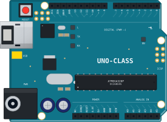</a> <a href="uno-class-board--indicators-lit.svg">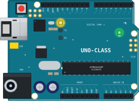</a> |
| Nano-class board<br>`nano-class-board` | <a href="nano-class-board.svg">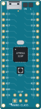</a> <a href="nano-class-board--indicators-lit.svg">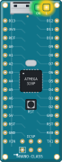</a> |
| Mega-class board<br>`mega-class-board` | <a href="mega-class-board.svg">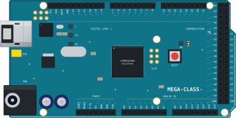</a> <a href="mega-class-board--indicators-lit.svg">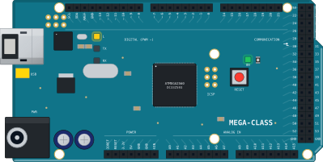</a> |
| RP2040 Nano-class board<br>`rp2040-nano-class-board` | <a href="rp2040-nano-class-board.svg">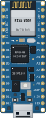</a> <a href="rp2040-nano-class-board--indicators-lit.svg">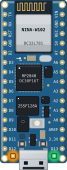</a> |
| Pico-class board<br>`pico-class-board` | <a href="pico-class-board.svg">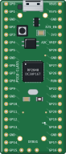</a> <a href="pico-class-board--indicators-lit.svg">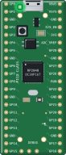</a> |
| ESP32 dev board, 30-pin<br>`esp32-dev-board-30-pin` | <a href="esp32-dev-board-30-pin.svg">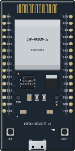</a> <a href="esp32-dev-board-30-pin--indicators-lit.svg">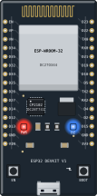</a> |
| ESP32 dev board, 38-pin<br>`esp32-dev-board-38-pin` | <a href="esp32-dev-board-38-pin.svg">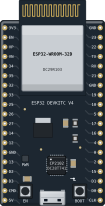</a> <a href="esp32-dev-board-38-pin--indicators-lit.svg">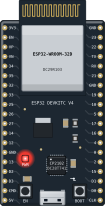</a> |
| ESP32-C3 dev board<br>`esp32-c3-dev-board` | <a href="esp32-c3-dev-board.svg">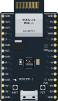</a> <a href="esp32-c3-dev-board--indicators-lit.svg">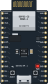</a> |
| ESP32-C5 dev board<br>`esp32-c5-dev-board` | <a href="esp32-c5-dev-board.svg">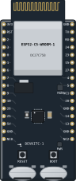</a> <a href="esp32-c5-dev-board--indicators-lit.svg">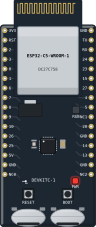</a> |
| ESP32-C6 dev board<br>`esp32-c6-dev-board` | <a href="esp32-c6-dev-board.svg">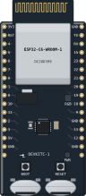</a> <a href="esp32-c6-dev-board--indicators-lit.svg">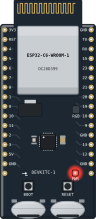</a> |
| ESP32-H2 dev board<br>`esp32-h2-dev-board` | <a href="esp32-h2-dev-board.svg">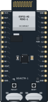</a> <a href="esp32-h2-dev-board--indicators-lit.svg">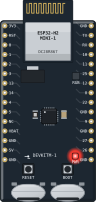</a> |
| ESP32-S2 dev board<br>`esp32-s2-dev-board` | <a href="esp32-s2-dev-board.svg">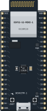</a> <a href="esp32-s2-dev-board--indicators-lit.svg">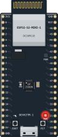</a> |
| ESP32-S3 dev board<br>`esp32-s3-dev-board` | <a href="esp32-s3-dev-board.svg">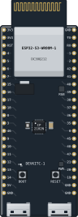</a> <a href="esp32-s3-dev-board--indicators-lit.svg">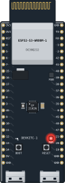</a> |
| STM32 board, 32-pin<br>`stm32-board-32-pin` | <a href="stm32-board-32-pin.svg">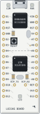</a> <a href="stm32-board-32-pin--indicators-lit.svg">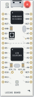</a> |
| STM32 board, 64-pin<br>`stm32-board-64-pin` | <a href="stm32-board-64-pin.svg">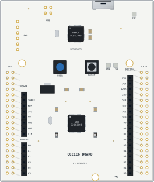</a> <a href="stm32-board-64-pin--indicators-lit.svg">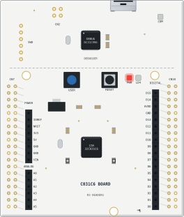</a> |
| STM32 Blue Pill<br>`stm32-blue-pill` | <a href="stm32-blue-pill.svg">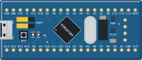</a> <a href="stm32-blue-pill--indicators-lit.svg">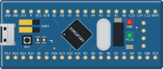</a> |
| Franzininho DIY<br>`franzininho-diy` | <a href="franzininho-diy.svg">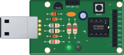</a> <a href="franzininho-diy--indicators-lit.svg">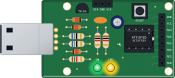</a> |

## Displays

| Part | Pictures |
| --- | --- |
| Character LCD, 16×2<br>`character-lcd-16x2` | <a href="character-lcd-16x2.svg">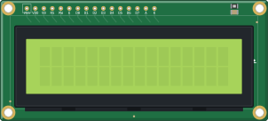</a> <a href="character-lcd-16x2--example.svg">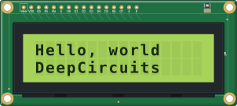</a> <a href="character-lcd-16x2--blue.svg">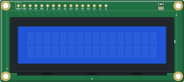</a> |
| Character LCD, 20×4<br>`character-lcd-20x4` | <a href="character-lcd-20x4.svg">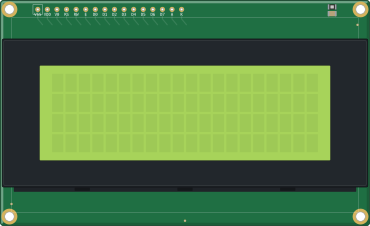</a> <a href="character-lcd-20x4--example.svg">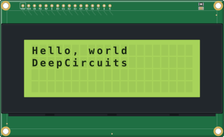</a> <a href="character-lcd-20x4--blue.svg">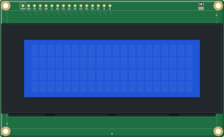</a> |
| OLED, 0.96″ I2C<br>`oled-0-96in-i2c` | <a href="oled-0-96in-i2c.svg">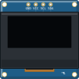</a> <a href="oled-0-96in-i2c--example.svg">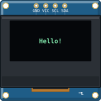</a> <a href="oled-0-96in-i2c--pixels-sine-wave.svg">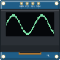</a> |
| OLED, 0.96″ SPI<br>`oled-0-96in-spi` | <a href="oled-0-96in-spi.svg">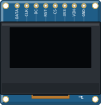</a> <a href="oled-0-96in-spi--example.svg">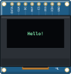</a> <a href="oled-0-96in-spi--pixels-sine-wave.svg">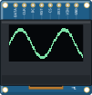</a> <a href="oled-0-96in-spi--green.svg">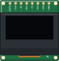</a> <a href="oled-0-96in-spi--teal.svg">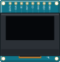</a> <a href="oled-0-96in-spi--black.svg">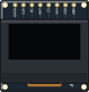</a> <a href="oled-0-96in-spi--purple.svg">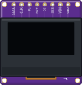</a> <a href="oled-0-96in-spi--white.svg"></a> <a href="oled-0-96in-spi--red.svg"></a> |
| OLED, 1.5″<br>`oled-1-5in` | <a href="oled-1-5in.svg"></a> <a href="oled-1-5in--example.svg"></a> <a href="oled-1-5in--pixels-sine-wave.svg"></a> |
| TFT display, 2.4″<br>`tft-display-2-4in` | <a href="tft-display-2-4in.svg"></a> <a href="tft-display-2-4in--example.svg"></a> <a href="tft-display-2-4in--pixels-sine-wave.svg"></a> <a href="tft-display-2-4in--blue.svg"></a> <a href="tft-display-2-4in--green.svg"></a> <a href="tft-display-2-4in--teal.svg"></a> <a href="tft-display-2-4in--black.svg"></a> <a href="tft-display-2-4in--purple.svg"></a> <a href="tft-display-2-4in--white.svg"></a> |
| TFT display, 2.8″ touch<br>`tft-display-2-8in-touch` | <a href="tft-display-2-8in-touch.svg"></a> <a href="tft-display-2-8in-touch--example.svg"></a> <a href="tft-display-2-8in-touch--pixels-sine-wave.svg"></a> |
| Graphic LCD, 84×48<br>`graphic-lcd-84x48` | <a href="graphic-lcd-84x48.svg"></a> <a href="graphic-lcd-84x48--example.svg"></a> <a href="graphic-lcd-84x48--pixels-sine-wave.svg"></a> <a href="graphic-lcd-84x48--blue.svg"></a> <a href="graphic-lcd-84x48--green.svg"></a> <a href="graphic-lcd-84x48--teal.svg"></a> <a href="graphic-lcd-84x48--black.svg"></a> <a href="graphic-lcd-84x48--purple.svg"></a> <a href="graphic-lcd-84x48--white.svg"></a> |
| E-paper display, 2.9″<br>`e-paper-display-2-9in` | <a href="e-paper-display-2-9in.svg"></a> <a href="e-paper-display-2-9in--example.svg"></a> <a href="e-paper-display-2-9in--pixels-sine-wave.svg"></a> <a href="e-paper-display-2-9in--green.svg"></a> <a href="e-paper-display-2-9in--teal.svg"></a> <a href="e-paper-display-2-9in--black.svg"></a> <a href="e-paper-display-2-9in--purple.svg"></a> <a href="e-paper-display-2-9in--white.svg"></a> <a href="e-paper-display-2-9in--red.svg"></a> |
| Seven-segment display, 1 digit<br>`seven-segment-display-1-digit` | <a href="seven-segment-display-1-digit.svg"></a> <a href="seven-segment-display-1-digit--green.svg"></a> <a href="seven-segment-display-1-digit--yellow.svg"></a> <a href="seven-segment-display-1-digit--blue.svg"></a> <a href="seven-segment-display-1-digit--white.svg"></a> <a href="seven-segment-display-1-digit--orange.svg"></a> |
| Seven-segment display, 4 digits<br>`seven-segment-display-4-digits` | <a href="seven-segment-display-4-digits.svg"></a> <a href="seven-segment-display-4-digits--colon.svg"></a> <a href="seven-segment-display-4-digits--green.svg"></a> <a href="seven-segment-display-4-digits--green--colon.svg"></a> <a href="seven-segment-display-4-digits--yellow.svg"></a> <a href="seven-segment-display-4-digits--yellow--colon.svg"></a> <a href="seven-segment-display-4-digits--blue.svg"></a> <a href="seven-segment-display-4-digits--blue--colon.svg"></a> <a href="seven-segment-display-4-digits--white.svg"></a> <a href="seven-segment-display-4-digits--white--colon.svg"></a> <a href="seven-segment-display-4-digits--orange.svg"></a> <a href="seven-segment-display-4-digits--orange--colon.svg"></a> |
| Clock display<br>`clock-display` | <a href="clock-display.svg"></a> <a href="clock-display--colon.svg"></a> <a href="clock-display--example.svg"></a> <a href="clock-display--green--colon.svg"></a> <a href="clock-display--yellow--colon.svg"></a> <a href="clock-display--blue--colon.svg"></a> <a href="clock-display--white--colon.svg"></a> <a href="clock-display--orange--colon.svg"></a> <a href="clock-display--green.svg"></a> <a href="clock-display--teal.svg"></a> <a href="clock-display--black.svg"></a> <a href="clock-display--purple.svg"></a> <a href="clock-display--white.svg"></a> <a href="clock-display--red.svg"></a> |
| LED matrix, 8×8<br>`led-matrix-8x8` | <a href="led-matrix-8x8.svg"></a> <a href="led-matrix-8x8--lit-heart.svg"></a> <a href="led-matrix-8x8--lit-smile.svg"></a> <a href="led-matrix-8x8--lit-arrow.svg"></a> |
| LED matrix, chain of 4<br>`led-matrix-chain-of-4` | <a href="led-matrix-chain-of-4.svg"></a> <a href="led-matrix-chain-of-4--lit-heart.svg"></a> <a href="led-matrix-chain-of-4--lit-smile.svg"></a> <a href="led-matrix-chain-of-4--lit-arrow.svg"></a> |
| RGB LED matrix, 8×8<br>`rgb-led-matrix-8x8` | <a href="rgb-led-matrix-8x8.svg"></a> |
| LED ring, 16 LEDs<br>`led-ring-16-leds` | <a href="led-ring-16-leds.svg"></a> |

## Sensors

| Part | Pictures |
| --- | --- |
| Ultrasonic ranger<br>`ultrasonic-ranger` | <a href="ultrasonic-ranger.svg"></a> <a href="ultrasonic-ranger--green.svg"></a> <a href="ultrasonic-ranger--teal.svg"></a> <a href="ultrasonic-ranger--black.svg"></a> <a href="ultrasonic-ranger--purple.svg"></a> <a href="ultrasonic-ranger--white.svg"></a> <a href="ultrasonic-ranger--red.svg"></a> |
| Temperature and humidity sensor<br>`temperature-and-humidity-sensor` | <a href="temperature-and-humidity-sensor.svg"></a> |
| Temperature and humidity module<br>`temperature-and-humidity-module` | <a href="temperature-and-humidity-module.svg"></a> <a href="temperature-and-humidity-module--indicators-lit.svg"></a> <a href="temperature-and-humidity-module--blue.svg"></a> <a href="temperature-and-humidity-module--green.svg"></a> <a href="temperature-and-humidity-module--teal.svg"></a> <a href="temperature-and-humidity-module--purple.svg"></a> <a href="temperature-and-humidity-module--white.svg"></a> <a href="temperature-and-humidity-module--red.svg"></a> |
| Pressure sensor, 4-pin<br>`pressure-sensor-4-pin` | <a href="pressure-sensor-4-pin.svg"></a> <a href="pressure-sensor-4-pin--green.svg"></a> <a href="pressure-sensor-4-pin--teal.svg"></a> <a href="pressure-sensor-4-pin--black.svg"></a> <a href="pressure-sensor-4-pin--purple.svg"></a> <a href="pressure-sensor-4-pin--white.svg"></a> <a href="pressure-sensor-4-pin--red.svg"></a> |
| Pressure sensor, 5-pin<br>`pressure-sensor-5-pin` | <a href="pressure-sensor-5-pin.svg"></a> <a href="pressure-sensor-5-pin--green.svg"></a> <a href="pressure-sensor-5-pin--teal.svg"></a> <a href="pressure-sensor-5-pin--black.svg"></a> <a href="pressure-sensor-5-pin--purple.svg"></a> <a href="pressure-sensor-5-pin--white.svg"></a> <a href="pressure-sensor-5-pin--red.svg"></a> |
| Light sensor<br>`light-sensor` | <a href="light-sensor.svg"></a> <a href="light-sensor--indicators-lit.svg"></a> <a href="light-sensor--green.svg"></a> <a href="light-sensor--teal.svg"></a> <a href="light-sensor--black.svg"></a> <a href="light-sensor--purple.svg"></a> <a href="light-sensor--white.svg"></a> <a href="light-sensor--red.svg"></a> |
| Flame sensor<br>`flame-sensor` | <a href="flame-sensor.svg"></a> <a href="flame-sensor--indicators-lit.svg"></a> <a href="flame-sensor--green.svg"></a> <a href="flame-sensor--teal.svg"></a> <a href="flame-sensor--black.svg"></a> <a href="flame-sensor--purple.svg"></a> <a href="flame-sensor--white.svg"></a> <a href="flame-sensor--red.svg"></a> |
| Sound sensor<br>`sound-sensor` | <a href="sound-sensor.svg"></a> <a href="sound-sensor--indicators-lit.svg"></a> <a href="sound-sensor--blue.svg"></a> <a href="sound-sensor--green.svg"></a> <a href="sound-sensor--teal.svg"></a> <a href="sound-sensor--black.svg"></a> <a href="sound-sensor--purple.svg"></a> <a href="sound-sensor--white.svg"></a> |
| Tilt switch<br>`tilt-switch` | <a href="tilt-switch.svg"></a> <a href="tilt-switch--indicators-lit.svg"></a> <a href="tilt-switch--green.svg"></a> <a href="tilt-switch--teal.svg"></a> <a href="tilt-switch--black.svg"></a> <a href="tilt-switch--purple.svg"></a> <a href="tilt-switch--white.svg"></a> <a href="tilt-switch--red.svg"></a> |
| Gas sensor<br>`gas-sensor` | <a href="gas-sensor.svg"></a> <a href="gas-sensor--indicators-lit.svg"></a> <a href="gas-sensor--green.svg"></a> <a href="gas-sensor--teal.svg"></a> <a href="gas-sensor--black.svg"></a> <a href="gas-sensor--purple.svg"></a> <a href="gas-sensor--white.svg"></a> <a href="gas-sensor--red.svg"></a> |
| IR receiver<br>`ir-receiver` | <a href="ir-receiver.svg"></a> <a href="ir-receiver--blue.svg"></a> <a href="ir-receiver--green.svg"></a> <a href="ir-receiver--teal.svg"></a> <a href="ir-receiver--purple.svg"></a> <a href="ir-receiver--white.svg"></a> <a href="ir-receiver--red.svg"></a> |
| NTC thermistor<br>`ntc-thermistor` | <a href="ntc-thermistor.svg"></a> <a href="ntc-thermistor--blue.svg"></a> <a href="ntc-thermistor--green.svg"></a> <a href="ntc-thermistor--teal.svg"></a> <a href="ntc-thermistor--purple.svg"></a> <a href="ntc-thermistor--white.svg"></a> <a href="ntc-thermistor--red.svg"></a> |
| PIR motion sensor<br>`pir-motion-sensor` | <a href="pir-motion-sensor.svg"></a> <a href="pir-motion-sensor--blue.svg"></a> <a href="pir-motion-sensor--teal.svg"></a> <a href="pir-motion-sensor--black.svg"></a> <a href="pir-motion-sensor--purple.svg"></a> <a href="pir-motion-sensor--white.svg"></a> <a href="pir-motion-sensor--red.svg"></a> |
| Accelerometer and gyro<br>`accelerometer-and-gyro` | <a href="accelerometer-and-gyro.svg"></a> <a href="accelerometer-and-gyro--green.svg"></a> <a href="accelerometer-and-gyro--teal.svg"></a> <a href="accelerometer-and-gyro--black.svg"></a> <a href="accelerometer-and-gyro--purple.svg"></a> <a href="accelerometer-and-gyro--white.svg"></a> <a href="accelerometer-and-gyro--red.svg"></a> |
| Pulse sensor<br>`pulse-sensor` | <a href="pulse-sensor.svg"></a> <a href="pulse-sensor--on.svg"></a> |
| DS18B20 temperature sensor<br>`ds18b20-temperature-sensor` | <a href="ds18b20-temperature-sensor.svg"></a> |
| Environment sensor<br>`environment-sensor` | <a href="environment-sensor.svg"></a> <a href="environment-sensor--blue.svg"></a> <a href="environment-sensor--green.svg"></a> <a href="environment-sensor--teal.svg"></a> <a href="environment-sensor--black.svg"></a> <a href="environment-sensor--white.svg"></a> <a href="environment-sensor--red.svg"></a> |
| Time-of-flight sensor<br>`time-of-flight-sensor` | <a href="time-of-flight-sensor.svg"></a> <a href="time-of-flight-sensor--blue.svg"></a> <a href="time-of-flight-sensor--green.svg"></a> <a href="time-of-flight-sensor--teal.svg"></a> <a href="time-of-flight-sensor--black.svg"></a> <a href="time-of-flight-sensor--white.svg"></a> <a href="time-of-flight-sensor--red.svg"></a> |
| Pulse oximeter<br>`pulse-oximeter` | <a href="pulse-oximeter.svg"></a> <a href="pulse-oximeter--blue.svg"></a> <a href="pulse-oximeter--green.svg"></a> <a href="pulse-oximeter--teal.svg"></a> <a href="pulse-oximeter--black.svg"></a> <a href="pulse-oximeter--white.svg"></a> <a href="pulse-oximeter--red.svg"></a> |
| LM35 temperature sensor<br>`lm35-temperature-sensor` | <a href="lm35-temperature-sensor.svg"></a> |
| TMP36 temperature sensor<br>`tmp36-temperature-sensor` | <a href="tmp36-temperature-sensor.svg"></a> |
| Soil moisture sensor<br>`soil-moisture-sensor` | <a href="soil-moisture-sensor.svg"></a> <a href="soil-moisture-sensor--indicators-lit.svg"></a> <a href="soil-moisture-sensor--green.svg"></a> <a href="soil-moisture-sensor--teal.svg"></a> <a href="soil-moisture-sensor--black.svg"></a> <a href="soil-moisture-sensor--purple.svg"></a> <a href="soil-moisture-sensor--white.svg"></a> <a href="soil-moisture-sensor--red.svg"></a> |
| Capacitive soil moisture sensor<br>`capacitive-soil-moisture-sensor` | <a href="capacitive-soil-moisture-sensor.svg"></a> <a href="capacitive-soil-moisture-sensor--blue.svg"></a> <a href="capacitive-soil-moisture-sensor--green.svg"></a> <a href="capacitive-soil-moisture-sensor--teal.svg"></a> <a href="capacitive-soil-moisture-sensor--purple.svg"></a> <a href="capacitive-soil-moisture-sensor--white.svg"></a> <a href="capacitive-soil-moisture-sensor--red.svg"></a> |
| Water level sensor<br>`water-level-sensor` | <a href="water-level-sensor.svg"></a> <a href="water-level-sensor--indicators-lit.svg"></a> <a href="water-level-sensor--blue.svg"></a> <a href="water-level-sensor--green.svg"></a> <a href="water-level-sensor--teal.svg"></a> <a href="water-level-sensor--black.svg"></a> <a href="water-level-sensor--purple.svg"></a> <a href="water-level-sensor--white.svg"></a> |
| Rain sensor<br>`rain-sensor` | <a href="rain-sensor.svg"></a> <a href="rain-sensor--indicators-lit.svg"></a> <a href="rain-sensor--green.svg"></a> <a href="rain-sensor--teal.svg"></a> <a href="rain-sensor--black.svg"></a> <a href="rain-sensor--purple.svg"></a> <a href="rain-sensor--white.svg"></a> <a href="rain-sensor--red.svg"></a> |
| IR obstacle sensor<br>`ir-obstacle-sensor` | <a href="ir-obstacle-sensor.svg"></a> <a href="ir-obstacle-sensor--indicators-lit.svg"></a> <a href="ir-obstacle-sensor--green.svg"></a> <a href="ir-obstacle-sensor--teal.svg"></a> <a href="ir-obstacle-sensor--black.svg"></a> <a href="ir-obstacle-sensor--purple.svg"></a> <a href="ir-obstacle-sensor--white.svg"></a> <a href="ir-obstacle-sensor--red.svg"></a> |
| Line tracking sensor<br>`line-tracking-sensor` | <a href="line-tracking-sensor.svg"></a> <a href="line-tracking-sensor--indicators-lit.svg"></a> <a href="line-tracking-sensor--green.svg"></a> <a href="line-tracking-sensor--teal.svg"></a> <a href="line-tracking-sensor--black.svg"></a> <a href="line-tracking-sensor--purple.svg"></a> <a href="line-tracking-sensor--white.svg"></a> <a href="line-tracking-sensor--red.svg"></a> |
| Voltage divider sensor<br>`voltage-divider-sensor` | <a href="voltage-divider-sensor.svg"></a> <a href="voltage-divider-sensor--blue.svg"></a> <a href="voltage-divider-sensor--green.svg"></a> <a href="voltage-divider-sensor--teal.svg"></a> <a href="voltage-divider-sensor--black.svg"></a> <a href="voltage-divider-sensor--purple.svg"></a> <a href="voltage-divider-sensor--white.svg"></a> |
| ACS712 current sensor<br>`acs712-current-sensor` | <a href="acs712-current-sensor.svg"></a> <a href="acs712-current-sensor--indicators-lit.svg"></a> <a href="acs712-current-sensor--blue.svg"></a> <a href="acs712-current-sensor--green.svg"></a> <a href="acs712-current-sensor--teal.svg"></a> <a href="acs712-current-sensor--black.svg"></a> <a href="acs712-current-sensor--purple.svg"></a> <a href="acs712-current-sensor--white.svg"></a> |
| Hall sensor<br>`hall-sensor` | <a href="hall-sensor.svg"></a> <a href="hall-sensor--indicators-lit.svg"></a> <a href="hall-sensor--blue.svg"></a> <a href="hall-sensor--green.svg"></a> <a href="hall-sensor--teal.svg"></a> <a href="hall-sensor--purple.svg"></a> <a href="hall-sensor--white.svg"></a> <a href="hall-sensor--red.svg"></a> |
| Linear hall sensor<br>`linear-hall-sensor` | <a href="linear-hall-sensor.svg"></a> <a href="linear-hall-sensor--indicators-lit.svg"></a> <a href="linear-hall-sensor--green.svg"></a> <a href="linear-hall-sensor--teal.svg"></a> <a href="linear-hall-sensor--black.svg"></a> <a href="linear-hall-sensor--purple.svg"></a> <a href="linear-hall-sensor--white.svg"></a> <a href="linear-hall-sensor--red.svg"></a> |
| Touch sensor<br>`touch-sensor` | <a href="touch-sensor.svg"></a> <a href="touch-sensor--indicators-lit.svg"></a> <a href="touch-sensor--blue.svg"></a> <a href="touch-sensor--green.svg"></a> <a href="touch-sensor--teal.svg"></a> <a href="touch-sensor--black.svg"></a> <a href="touch-sensor--purple.svg"></a> <a href="touch-sensor--white.svg"></a> |
| Vibration sensor<br>`vibration-sensor` | <a href="vibration-sensor.svg"></a> <a href="vibration-sensor--indicators-lit.svg"></a> <a href="vibration-sensor--green.svg"></a> <a href="vibration-sensor--teal.svg"></a> <a href="vibration-sensor--black.svg"></a> <a href="vibration-sensor--purple.svg"></a> <a href="vibration-sensor--white.svg"></a> <a href="vibration-sensor--red.svg"></a> |
| Reed switch<br>`reed-switch` | <a href="reed-switch.svg"></a> <a href="reed-switch--closed.svg"></a> |
| Digital temperature sensor<br>`digital-temperature-sensor` | <a href="digital-temperature-sensor.svg"></a> <a href="digital-temperature-sensor--indicators-lit.svg"></a> <a href="digital-temperature-sensor--blue.svg"></a> <a href="digital-temperature-sensor--green.svg"></a> <a href="digital-temperature-sensor--teal.svg"></a> <a href="digital-temperature-sensor--black.svg"></a> <a href="digital-temperature-sensor--purple.svg"></a> <a href="digital-temperature-sensor--white.svg"></a> |
| Photo interrupter<br>`photo-interrupter` | <a href="photo-interrupter.svg"></a> <a href="photo-interrupter--blue.svg"></a> <a href="photo-interrupter--green.svg"></a> <a href="photo-interrupter--teal.svg"></a> <a href="photo-interrupter--purple.svg"></a> <a href="photo-interrupter--white.svg"></a> <a href="photo-interrupter--red.svg"></a> |
| Knock sensor<br>`knock-sensor` | <a href="knock-sensor.svg"></a> <a href="knock-sensor--blue.svg"></a> <a href="knock-sensor--green.svg"></a> <a href="knock-sensor--teal.svg"></a> <a href="knock-sensor--purple.svg"></a> <a href="knock-sensor--white.svg"></a> <a href="knock-sensor--red.svg"></a> |

## Inputs

| Part | Pictures |
| --- | --- |
| Pushbutton<br>`pushbutton` | <a href="pushbutton.svg"></a> <a href="pushbutton--pressed.svg"></a> <a href="pushbutton--red.svg"></a> <a href="pushbutton--red--pressed.svg"></a> <a href="pushbutton--green.svg"></a> <a href="pushbutton--green--pressed.svg"></a> <a href="pushbutton--yellow.svg"></a> <a href="pushbutton--yellow--pressed.svg"></a> <a href="pushbutton--blue.svg"></a> <a href="pushbutton--blue--pressed.svg"></a> <a href="pushbutton--white.svg"></a> <a href="pushbutton--white--pressed.svg"></a> <a href="pushbutton--orange.svg"></a> <a href="pushbutton--orange--pressed.svg"></a> |
| Pushbutton, 6 mm<br>`pushbutton-6-mm` | <a href="pushbutton-6-mm.svg"></a> <a href="pushbutton-6-mm--pressed.svg"></a> <a href="pushbutton-6-mm--red.svg"></a> <a href="pushbutton-6-mm--red--pressed.svg"></a> <a href="pushbutton-6-mm--green.svg"></a> <a href="pushbutton-6-mm--green--pressed.svg"></a> <a href="pushbutton-6-mm--yellow.svg"></a> <a href="pushbutton-6-mm--yellow--pressed.svg"></a> <a href="pushbutton-6-mm--blue.svg"></a> <a href="pushbutton-6-mm--blue--pressed.svg"></a> <a href="pushbutton-6-mm--white.svg"></a> <a href="pushbutton-6-mm--white--pressed.svg"></a> <a href="pushbutton-6-mm--orange.svg"></a> <a href="pushbutton-6-mm--orange--pressed.svg"></a> |
| Potentiometer<br>`potentiometer` | <a href="potentiometer.svg"></a> <a href="potentiometer--position-0.svg"></a> <a href="potentiometer--position-1.svg"></a> |
| Slide potentiometer<br>`slide-potentiometer` | <a href="slide-potentiometer.svg"></a> <a href="slide-potentiometer--position-1.svg"></a> |
| Slide switch<br>`slide-switch` | <a href="slide-switch.svg"></a> |
| Rotary encoder<br>`rotary-encoder` | <a href="rotary-encoder.svg"></a> <a href="rotary-encoder--pressed.svg"></a> <a href="rotary-encoder--detent-19.svg"></a> <a href="rotary-encoder--blue.svg"></a> <a href="rotary-encoder--green.svg"></a> <a href="rotary-encoder--teal.svg"></a> <a href="rotary-encoder--purple.svg"></a> <a href="rotary-encoder--white.svg"></a> <a href="rotary-encoder--red.svg"></a> |
| Joystick<br>`joystick` | <a href="joystick.svg"></a> <a href="joystick--pressed.svg"></a> <a href="joystick--x-minus-1.svg"></a> <a href="joystick--x-1.svg"></a> <a href="joystick--y-minus-1.svg"></a> <a href="joystick--y-1.svg"></a> <a href="joystick--blue.svg"></a> <a href="joystick--green.svg"></a> <a href="joystick--teal.svg"></a> <a href="joystick--purple.svg"></a> <a href="joystick--white.svg"></a> <a href="joystick--red.svg"></a> |
| Keypad, 4×4<br>`keypad-4x4` | <a href="keypad-4x4.svg"></a> <a href="keypad-4x4--pressed-1.svg"></a> <a href="keypad-4x4--pressed-5.svg"></a> <a href="keypad-4x4--pressed-9.svg"></a> <a href="keypad-4x4--pressed-a.svg"></a> <a href="keypad-4x4--pressed-star.svg"></a> <a href="keypad-4x4--pressed-hash.svg"></a> |
| DIP switch, 8-way<br>`dip-switch-8-way` | <a href="dip-switch-8-way.svg"></a> |
| IR remote<br>`ir-remote` | <a href="ir-remote.svg"></a> |
| Rotary dialer<br>`rotary-dialer` | <a href="rotary-dialer.svg"></a> <a href="rotary-dialer--angle-324.svg"></a> |

## Outputs

| Part | Pictures |
| --- | --- |
| LED, 5 mm<br>`led-5-mm` | <a href="led-5-mm.svg"></a> <a href="led-5-mm--on.svg"></a> <a href="led-5-mm--green.svg"></a> <a href="led-5-mm--green--on.svg"></a> <a href="led-5-mm--yellow.svg"></a> <a href="led-5-mm--yellow--on.svg"></a> <a href="led-5-mm--blue.svg"></a> <a href="led-5-mm--blue--on.svg"></a> <a href="led-5-mm--white.svg"></a> <a href="led-5-mm--white--on.svg"></a> <a href="led-5-mm--orange.svg"></a> <a href="led-5-mm--orange--on.svg"></a> |
| RGB LED<br>`rgb-led` | <a href="rgb-led.svg"></a> <a href="rgb-led--r-1.svg"></a> <a href="rgb-led--g-1.svg"></a> <a href="rgb-led--b-1.svg"></a> |
| LED bar graph<br>`led-bar-graph` | <a href="led-bar-graph.svg"></a> <a href="led-bar-graph--green.svg"></a> <a href="led-bar-graph--yellow.svg"></a> <a href="led-bar-graph--blue.svg"></a> <a href="led-bar-graph--white.svg"></a> <a href="led-bar-graph--orange.svg"></a> |
| Addressable LED<br>`addressable-led` | <a href="addressable-led.svg"></a> <a href="addressable-led--r-1.svg"></a> <a href="addressable-led--g-1.svg"></a> <a href="addressable-led--b-1.svg"></a> |
| Addressable LED strip<br>`addressable-led-strip` | <a href="addressable-led-strip.svg"></a> |
| Piezo buzzer<br>`piezo-buzzer` | <a href="piezo-buzzer.svg"></a> |
| Active buzzer<br>`active-buzzer` | <a href="active-buzzer.svg"></a> |
| Servo<br>`servo` | <a href="servo.svg"></a> <a href="servo--angle-minus-90.svg"></a> <a href="servo--angle-90.svg"></a> |
| Stepper motor<br>`stepper-motor` | <a href="stepper-motor.svg"></a> |
| Biaxial stepper<br>`biaxial-stepper` | <a href="biaxial-stepper.svg"></a> |
| DPDT relay<br>`dpdt-relay` | <a href="dpdt-relay.svg"></a> <a href="dpdt-relay--energised.svg"></a> |
| DC motor<br>`dc-motor` | <a href="dc-motor.svg"></a> |
| DC gear motor<br>`dc-gear-motor` | <a href="dc-gear-motor.svg"></a> |
| Water pump<br>`water-pump` | <a href="water-pump.svg"></a> <a href="water-pump--running.svg"></a> |
| Solenoid<br>`solenoid` | <a href="solenoid.svg"></a> <a href="solenoid--position-1.svg"></a> |

## Modules

| Part | Pictures |
| --- | --- |
| Relay module<br>`relay-module` | <a href="relay-module.svg"></a> <a href="relay-module--indicators-lit.svg"></a> <a href="relay-module--blue.svg"></a> <a href="relay-module--green.svg"></a> <a href="relay-module--teal.svg"></a> <a href="relay-module--black.svg"></a> <a href="relay-module--purple.svg"></a> <a href="relay-module--white.svg"></a> |
| Relay module, 2-channel<br>`relay-module-2-channel` | <a href="relay-module-2-channel.svg"></a> <a href="relay-module-2-channel--indicators-lit.svg"></a> <a href="relay-module-2-channel--green.svg"></a> <a href="relay-module-2-channel--teal.svg"></a> <a href="relay-module-2-channel--black.svg"></a> <a href="relay-module-2-channel--purple.svg"></a> <a href="relay-module-2-channel--white.svg"></a> <a href="relay-module-2-channel--red.svg"></a> |
| Relay module, 4-channel<br>`relay-module-4-channel` | <a href="relay-module-4-channel.svg"></a> <a href="relay-module-4-channel--indicators-lit.svg"></a> <a href="relay-module-4-channel--green.svg"></a> <a href="relay-module-4-channel--teal.svg"></a> <a href="relay-module-4-channel--black.svg"></a> <a href="relay-module-4-channel--purple.svg"></a> <a href="relay-module-4-channel--white.svg"></a> <a href="relay-module-4-channel--red.svg"></a> |
| Relay module, 8-channel<br>`relay-module-8-channel` | <a href="relay-module-8-channel.svg"></a> <a href="relay-module-8-channel--indicators-lit.svg"></a> <a href="relay-module-8-channel--green.svg"></a> <a href="relay-module-8-channel--teal.svg"></a> <a href="relay-module-8-channel--black.svg"></a> <a href="relay-module-8-channel--purple.svg"></a> <a href="relay-module-8-channel--white.svg"></a> <a href="relay-module-8-channel--red.svg"></a> |
| Load cell amplifier<br>`load-cell-amplifier` | <a href="load-cell-amplifier.svg"></a> <a href="load-cell-amplifier--blue.svg"></a> <a href="load-cell-amplifier--green.svg"></a> <a href="load-cell-amplifier--teal.svg"></a> <a href="load-cell-amplifier--black.svg"></a> <a href="load-cell-amplifier--purple.svg"></a> <a href="load-cell-amplifier--white.svg"></a> |
| microSD card module<br>`microsd-card-module` | <a href="microsd-card-module.svg"></a> <a href="microsd-card-module--green.svg"></a> <a href="microsd-card-module--teal.svg"></a> <a href="microsd-card-module--black.svg"></a> <a href="microsd-card-module--purple.svg"></a> <a href="microsd-card-module--white.svg"></a> <a href="microsd-card-module--red.svg"></a> |
| Regulator module, 3.3 V<br>`regulator-module-3-3-v` | <a href="regulator-module-3-3-v.svg"></a> <a href="regulator-module-3-3-v--indicators-lit.svg"></a> <a href="regulator-module-3-3-v--green.svg"></a> <a href="regulator-module-3-3-v--teal.svg"></a> <a href="regulator-module-3-3-v--black.svg"></a> <a href="regulator-module-3-3-v--purple.svg"></a> <a href="regulator-module-3-3-v--white.svg"></a> <a href="regulator-module-3-3-v--red.svg"></a> |
| Breadboard power module<br>`breadboard-power-module` | <a href="breadboard-power-module.svg"></a> <a href="breadboard-power-module--indicators-lit.svg"></a> <a href="breadboard-power-module--blue.svg"></a> <a href="breadboard-power-module--green.svg"></a> <a href="breadboard-power-module--teal.svg"></a> <a href="breadboard-power-module--black.svg"></a> <a href="breadboard-power-module--purple.svg"></a> <a href="breadboard-power-module--white.svg"></a> |
| L298N motor driver<br>`l298n-motor-driver` | <a href="l298n-motor-driver.svg"></a> <a href="l298n-motor-driver--indicators-lit.svg"></a> <a href="l298n-motor-driver--blue.svg"></a> <a href="l298n-motor-driver--green.svg"></a> <a href="l298n-motor-driver--teal.svg"></a> <a href="l298n-motor-driver--black.svg"></a> <a href="l298n-motor-driver--purple.svg"></a> <a href="l298n-motor-driver--white.svg"></a> |
| Real-time clock<br>`real-time-clock` | <a href="real-time-clock.svg"></a> <a href="real-time-clock--green.svg"></a> <a href="real-time-clock--teal.svg"></a> <a href="real-time-clock--black.svg"></a> <a href="real-time-clock--purple.svg"></a> <a href="real-time-clock--white.svg"></a> <a href="real-time-clock--red.svg"></a> |
| Precision real-time clock<br>`precision-real-time-clock` | <a href="precision-real-time-clock.svg"></a> <a href="precision-real-time-clock--indicators-lit.svg"></a> <a href="precision-real-time-clock--green.svg"></a> <a href="precision-real-time-clock--teal.svg"></a> <a href="precision-real-time-clock--black.svg"></a> <a href="precision-real-time-clock--purple.svg"></a> <a href="precision-real-time-clock--white.svg"></a> <a href="precision-real-time-clock--red.svg"></a> |
| RFID reader<br>`rfid-reader` | <a href="rfid-reader.svg"></a> <a href="rfid-reader--indicators-lit.svg"></a> <a href="rfid-reader--green.svg"></a> <a href="rfid-reader--teal.svg"></a> <a href="rfid-reader--black.svg"></a> <a href="rfid-reader--purple.svg"></a> <a href="rfid-reader--white.svg"></a> <a href="rfid-reader--red.svg"></a> |
| Logic analyzer<br>`logic-analyzer` | <a href="logic-analyzer.svg"></a> <a href="logic-analyzer--samples-1000000.svg"></a> <a href="logic-analyzer--activity-1.svg"></a> |
| Pixel meter<br>`pixel-meter` | <a href="pixel-meter.svg"></a> |
| Analog multiplexer, 16-channel<br>`analog-multiplexer-16-channel` | <a href="analog-multiplexer-16-channel.svg"></a> <a href="analog-multiplexer-16-channel--blue.svg"></a> <a href="analog-multiplexer-16-channel--green.svg"></a> <a href="analog-multiplexer-16-channel--teal.svg"></a> <a href="analog-multiplexer-16-channel--black.svg"></a> <a href="analog-multiplexer-16-channel--white.svg"></a> <a href="analog-multiplexer-16-channel--red.svg"></a> |

## Chips

| Part | Pictures |
| --- | --- |
| NE555 timer<br>`ne555-timer` | <a href="ne555-timer.svg"></a> |
| Shift register, 74HC595<br>`shift-register-74hc595` | <a href="shift-register-74hc595.svg"></a> |
| Shift register, 74HC165<br>`shift-register-74hc165` | <a href="shift-register-74hc165.svg"></a> |
| NLSF595 driver<br>`nlsf595-driver` | <a href="nlsf595-driver.svg"></a> |
| ATtiny85<br>`attiny85` | <a href="attiny85.svg"></a> |
| Transistor, TO-92<br>`transistor-to-92` | <a href="transistor-to-92.svg"></a> |
| Transistor, TO-220<br>`transistor-to-220` | <a href="transistor-to-220.svg"></a> |
| Voltage regulator, TO-220<br>`voltage-regulator-to-220` | <a href="voltage-regulator-to-220.svg"></a> |

## Passives

| Part | Pictures |
| --- | --- |
| Resistor<br>`resistor` | <a href="resistor.svg"></a> <a href="resistor--ohms-220.svg"></a> <a href="resistor--ohms-10000.svg"></a> <a href="resistor--ohms-100000.svg"></a> |
| Battery holder<br>`battery-holder` | <a href="battery-holder.svg"></a> |
| Electrolytic capacitor<br>`electrolytic-capacitor` | <a href="electrolytic-capacitor.svg"></a> |
| Ceramic capacitor<br>`ceramic-capacitor` | <a href="ceramic-capacitor.svg"></a> <a href="ceramic-capacitor--code-10-nf.svg"></a> <a href="ceramic-capacitor--code-2-2-nf.svg"></a> <a href="ceramic-capacitor--code-22-pf.svg"></a> |

## Breadboards

| Part | Pictures |
| --- | --- |
| Mini breadboard<br>`mini-breadboard` | <a href="mini-breadboard.svg"></a> <a href="mini-breadboard--red.svg"></a> <a href="mini-breadboard--orange.svg"></a> <a href="mini-breadboard--yellow.svg"></a> <a href="mini-breadboard--green.svg"></a> <a href="mini-breadboard--blue.svg"></a> <a href="mini-breadboard--purple.svg"></a> <a href="mini-breadboard--brown.svg"></a> <a href="mini-breadboard--black.svg"></a> |
| Half breadboard<br>`half-breadboard` | <a href="half-breadboard.svg"></a> <a href="half-breadboard--red.svg"></a> <a href="half-breadboard--orange.svg"></a> <a href="half-breadboard--yellow.svg"></a> <a href="half-breadboard--green.svg"></a> <a href="half-breadboard--blue.svg"></a> <a href="half-breadboard--purple.svg"></a> <a href="half-breadboard--brown.svg"></a> <a href="half-breadboard--black.svg"></a> |
| Full breadboard<br>`full-breadboard` | <a href="full-breadboard.svg"></a> <a href="full-breadboard--red.svg"></a> <a href="full-breadboard--orange.svg"></a> <a href="full-breadboard--yellow.svg"></a> <a href="full-breadboard--green.svg"></a> <a href="full-breadboard--blue.svg"></a> <a href="full-breadboard--purple.svg"></a> <a href="full-breadboard--brown.svg"></a> <a href="full-breadboard--black.svg"></a> |

## Symbols

| Part | Pictures |
| --- | --- |
| AND gate<br>`and-gate` | <a href="and-gate.svg"></a> |
| NAND gate<br>`nand-gate` | <a href="nand-gate.svg"></a> |
| OR gate<br>`or-gate` | <a href="or-gate.svg"></a> |
| NOR gate<br>`nor-gate` | <a href="nor-gate.svg"></a> |
| XOR gate<br>`xor-gate` | <a href="xor-gate.svg"></a> |
| XNOR gate<br>`xnor-gate` | <a href="xnor-gate.svg"></a> |
| NOT gate<br>`not-gate` | <a href="not-gate.svg"></a> |
| Buffer<br>`buffer` | <a href="buffer.svg"></a> |
| Multiplexer<br>`multiplexer` | <a href="multiplexer.svg"></a> |
| D flip-flop<br>`d-flip-flop` | <a href="d-flip-flop.svg"></a> |
| D flip-flop with set and reset<br>`d-flip-flop-with-set-and-reset` | <a href="d-flip-flop-with-set-and-reset.svg"></a> |
| Clock source<br>`clock-source` | <a href="clock-source.svg"></a> |
| Supply<br>`supply` | <a href="supply.svg"></a> |
